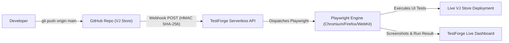

# 🛍️ VJ Store — Deterministic E-Commerce Storefront

<p align="center">
  
  
  
  
  <a href="https://github.com/VIJAYAPANDIANT/testforge"></a>
  
  
</p>

**VJ Store** is a modern, high-performance e-commerce web application engineered with **React 19**, **TypeScript**, **TanStack Start & Router**, and **Tailwind CSS v4**.

Unlike conventional mock demo shops, VJ Store is architected specifically with **deterministic DOM hierarchies, stable `data-testid` selectors, and semantic accessible ARIA roles**, making it the premier, zero-flake target application for automated browser testing platforms like [**TestForge**](https://github.com/VIJAYAPANDIANT/testforge), Playwright, and Cypress.

---

## ⚡ Key Highlights

* 🎯 **Zero-Flake Automation Design**: Clean, permanent element identifiers (`data-testid`, semantic button/heading roles) eliminate brittle CSS paths and dynamic class selectors.
* 🌓 **Dynamic Theme Engine**: Seamless Light Mode ☀️ and Dark Mode 🌙 switching with system OS preference detection, zero-flicker SSR script, and local persistence.
* 🛒 **Complete E-Commerce Workflows**: Interactive product catalog grid, real-time keyword search, category filters, cart persistence, and a multi-step checkout form with field validation.
* 📦 **Edge-Case Inventory Simulation**: Deliberate out-of-stock items (*Leather Backpack*) with disabled buttons and visual stock tags for negative test assertions.
* 🤖 **Native TestForge CI/CD Integration**: Direct webhook pipeline connected to the [TestForge Automation Platform](https://testforge-client.vercel.app) with HMAC SHA-256 signature verification.
* 🔄 **One-Click State Reset**: Instant `Reset demo data` action in the footer resets all localStorage keys (`tf_auth`, `tf_cart`, `tf_last_order`, `tf_order_seq`) between test runs.

---

## 🔗 TestForge CI/CD Automation Pipeline

VJ Store is connected directly to the [**TestForge Automation Platform**](https://github.com/VIJAYAPANDIANT/testforge). Every push to `main` automatically triggers cryptographic webhook notifications to run automated Playwright smoke and regression suites:



### Webhook Specification

| Parameter | Value |
| :--- | :--- |
| **Parent Platform** | [VIJAYAPANDIANT/testforge](https://github.com/VIJAYAPANDIANT/testforge) |
| **Target Project** | TestForge E-Commerce (Project ID: `6ad38cd009236f514119ac6d`) |
| **Webhook Endpoint** | `https://testforge-server.vercel.app/api/webhooks/github/6ad38cd009236f514119ac6d` |
| **Trigger Event** | `push` on branch `main` |
| **Security** | `X-Hub-Signature-256` HMAC cryptographic validation |
| **Automated Suites** | Automatically queues and runs "Navigate" and smoke test cases |
| **Platform Demo Login** | `vijayt@gmail.com` |

---

## 🔑 Demo Account Credentials

Use the following mock account to log in and test checkout workflows:

| Field | Value | Notes |
| :--- | :--- | :--- |
| **Email** | `user@test.com` | Stored in `tf_auth` |
| **Password** | `password123` | Deterministic client-side validation |

> [!NOTE]
> Client-side authentication for automated testing consistency. Never enter real personal passwords.

---

## 📋 Automation & Locator Cheat Sheet

Use these stable attributes when authoring test cases in the **TestForge Visual Builder**, **Playwright**, or **Cypress**:

| Target Element | Recommended Strategy | Locator Value / Selector |
| :--- | :--- | :--- |
| **Logo / Home** | `css` / `data-testid` | `[data-testid="nav-logo"]` |
| **About Link** | `css` / `data-testid` | `[data-testid="nav-about"]` |
| **Products Link** | `css` / `data-testid` | `[data-testid="nav-products"]` |
| **Theme Toggle** | `css` / `role` | `button[data-testid="theme-toggle"]` |
| **Search Bar** | `css` / `data-testid` | `input[data-testid="product-search"]` |
| **Category Pill** | `css` / `data-testid` | `button[data-testid="category-{all\|electronics\|fashion\|home\|accessories}"]` |
| **Product Card** | `css` / `data-testid` | `div[data-testid="product-card-{id}"]` |
| **Add to Cart** | `css` / `role` | `button[data-testid="add-to-cart-{id}"]` or `button:has-text("Add to Cart")` |
| **Cart Badge Count** | `css` / `data-testid` | `span[data-testid="cart-count"]` |
| **Cart Nav Trigger** | `css` / `data-testid` | `a[data-testid="nav-cart"]` |
| **Cart Quantity + / -** | `css` / `data-testid` | `button[data-testid="cart-item-{id}-increase"]`, `...-decrease` |
| **Remove Item** | `css` / `data-testid` | `button[data-testid="remove-{id}"]` |
| **Cart Subtotal** | `css` / `data-testid` | `span[data-testid="cart-subtotal"]` |
| **Checkout Proceed** | `css` / `role` | `button[data-testid="proceed-to-checkout"]` or `button:has-text("Proceed to Checkout")` |
| **Checkout Inputs** | `css` / `data-testid` | `input[data-testid="checkout-full-name\|email\|phone\|address\|city\|postal-code"]` |
| **Checkout Submit** | `css` / `role` | `button[data-testid="checkout-submit"]` or `button:has-text("Place Order")` |
| **Order Success Box** | `css` / `data-testid` | `div[data-testid="order-success"]` |
| **Order Receipt ID** | `css` / `data-testid` | `span[data-testid="order-id"]` (format `TF-\d{6}`) |
| **Reset Demo State** | `css` / `data-testid` | `button[data-testid="reset-demo"]` |

---

## 📦 Fixed Product Catalog

The catalog is purposefully fixed to ensure assertions remain 100% deterministic:

| Product ID | Name | Category | Price | In Stock |
| :--- | :--- | :--- | :---: | :---: |
| `wireless-headphones` | Wireless Headphones | Electronics | **$129.99** | ✅ Yes |
| `smart-watch` | Smart Watch | Electronics | **$199.00** | ✅ Yes |
| `denim-jacket` | Denim Jacket | Fashion | **$79.50** | ✅ Yes |
| `white-sneakers` | White Sneakers | Fashion | **$89.00** | ✅ Yes |
| `ceramic-lamp` | Ceramic Table Lamp | Home | **$64.00** | ✅ Yes |
| `leather-backpack` | Leather Backpack | Accessories | **$149.00** | ❌ **No (Out of Stock)** |

### Shipping & Quantity Rules
- **Flat Shipping**: **$5.99** for orders under **$100.00**.
- **Free Shipping**: **$0.00** for orders **$100.00+**.
- **Quantity Limits**: Clamped strictly between **1 and 10** items per product.
- **Sequential Receipts**: Browser order generator produces sequential receipts (`TF-100001`, `TF-100002`, ...).

---

## 🗺️ Application Routes

| Route | View Purpose | Description |
| :--- | :--- | :--- |
| **`/`** | Root Entry | Redirects directly to `/about` on first load |
| **`/about`** | About Hub | In-page showcase with credentials, catalog breakdown, and rules |
| **`/login`** | Demo Login | Authentication view with credential helper cards |
| **`/products`** | Product Catalog | Grid view with search filter and category pill navigation |
| **`/products/:productId`** | Product Details | Product specs, stock indicator, quantity clamp, add to cart |
| **`/cart`** | Shopping Cart | Item counters, line-item removal, pricing subtotal calculation |
| **`/checkout`** | Delivery Form | 6-field address validation & summary (requires login & cart) |
| **`/success`** | Confirmation | Receipt display with sequential order ID (`TF-100001`) |

---

## 💻 Tech Stack

| Layer | Technology | Purpose |
| :--- | :--- | :--- |
| **UI Framework** | [React 19](https://react.dev/) | Component architecture & modern state rendering |
| **Language** | [TypeScript](https://www.typescriptlang.org/) | Strict static typing across all routes and models |
| **Bundler & Server** | [Vite 8](https://vitejs.dev/) | Instant HMR and optimized production bundles |
| **Routing** | [TanStack Router](https://tanstack.com/router) | Type-safe file-based SSR and client routing |
| **Styling** | [Tailwind CSS v4](https://tailwindcss.com/) | Modern CSS variables & OKLCH color palettes |
| **Icons** | [Lucide React](https://lucide.dev/) | Clean, accessible vector UI icons |
| **State Management** | React Context | Isolated `AuthContext`, `CartContext`, `ThemeContext` |
| **Testing** | [Vitest](https://vitest.dev/) | Unit tests for pricing math, cart rules, and routes |
| **CI/CD Automation** | [TestForge](https://testforge-client.vercel.app) | Automated Webhook-triggered Playwright test suites |

---

## 🛠️ Local Development

### 1. Clone Repository
```bash
git clone https://github.com/VIJAYAPANDIANT/testforge-e-commerce.git
cd testforge-e-commerce
```

### 2. Install Dependencies
```bash
pnpm install
# or: npm install
```

### 3. Start Development Server
```bash
pnpm run dev
# or: npm run dev
```
Open **[http://localhost:8080](http://localhost:8080)** (or Vite port **[http://localhost:5173](http://localhost:5173)**) in your browser.

### 4. Run Test Suite
```bash
# Run Vitest business rules and routing tests
pnpm test

# Type-check
pnpm exec tsc --noEmit

# Production build
pnpm run build
```

---

## 📄 License

This repository is licensed under the [MIT License](LICENSE). Built for automated testing and testbed simulation.
